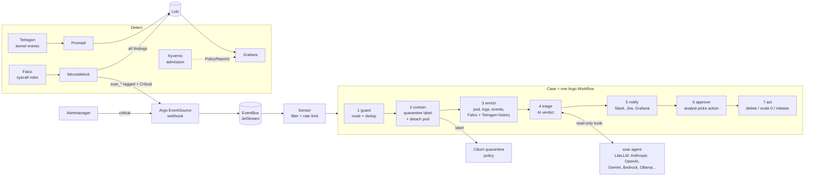

# k8s-soar

> Kubernetes runtime **detection → automated containment → AI-assisted triage → human-approved response**.
> Falco + Tetragon + Kyverno + Cilium, orchestrated by Argo Events/Workflows, with an optional LLM triage agent (bring your own provider).

[](https://github.com/joesabbagh1/k8s-soar/actions/workflows/ci.yml)

---

## What happens when an attack is detected



Concretely, for `kubectl exec` into a pod followed by `cat /var/run/secrets/.../token`:

1. **Falco** matches `K8sSoar Service Account Token Read By Shell Tool` (tags `soar_contain`, `T1552.007`).
2. **falcosidekick** posts the JSON event to the in-cluster webhook; the **Sensor** opens a case: a Workflow named `k8ssoar-service-account-token-read-by-shell-tool-xxxxx`, labelled with the namespace and pod.
3. **guard** checks the namespace isn't a platform namespace, the pod isn't already quarantined, and the same alert wasn't handled in the last 10 minutes (atomic claim on the pod).
4. **contain** labels the pod `security.quarantine=true` → the Cilium policy cuts all its traffic (kubelet probes still pass, so the process stays alive for forensics), and removes its ReplicaSet selector labels → the Deployment schedules a clean replacement and Services stop routing to it. Typical time-to-contain: a few seconds.
5. **enrich** collects pod spec, owner chain, events, recent logs, other Falco alerts and Tetragon events for that pod.
6. **triage** (optional) asks the AI agent for a verdict: `true_positive | benign | needs_review`, confidence, evidence and recommended next action.
7. **notify** posts to Slack, opens a Jira issue (MITRE mapping, evidence, AI summary, links) and annotates Grafana — each only if configured.
8. **approve** pauses the case. An analyst opens it in the Argo UI and resumes with `delete-pod`, `scale-to-zero`, `release-quarantine` or `none`. Nothing destructive happens without a human.

Every step's inputs, outputs and logs are visible in the Argo UI (`make argo-ui`). `make cases` lists them in the terminal.

## Quick start

**Bare metal, from scratch** (Ubuntu 22.04+, kernel ≥ 5.10):

```bash
cd deploy/ansible && ./setup.sh        # kubeadm cluster + full stack
```

**Existing cluster** (no CNI yet, or already Cilium — see [operations](docs/operations.md)):

```bash
make preflight                         # tools + cluster checks
cp deploy/secrets.env.example deploy/secrets.env   # optional: Slack, Jira, AI key
make deploy                            # helmfile apply (ENV=lab adds the security-lab namespace)
make status                            # health check
make smoke-test                        # trigger a rule, verify containment end to end
```

**Turn on AI triage:**

```yaml
# deploy/profiles/default.yaml
k8sSoar:
  ai:
    enabled: true
    provider: anthropic        # anthropic | openai | gemini | azure | bedrock | ollama | ...
    model: claude-sonnet-5-5
```

```bash
make ai-key KEY=<your provider key> && make deploy
```

## Repository layout

```text
deploy/
  ansible/              kubeadm bootstrap (cluster only) → then runs helmfile
  helmfile.yaml.gotmpl  every Helm release, pinned versions, install order
  profiles/             the settings you change (default.yaml, lab.yaml)
  values/               per-component Helm values (Cilium, Falco, Argo, ...)
charts/k8s-soar/        k8s-soar's own resources
  files/falco-rules/    detection rules by MITRE tactic
  templates/detection/  Kyverno + Tetragon policies, Falco rules ConfigMap
  templates/response/   quarantine policy, Argo EventSource/Sensor/WorkflowTemplate, RBAC
  templates/agent/      AI triage agent
services/soar/          Python: workflow steps (soar-actions) + AI agent (soar-agent)
scripts/                verify, smoke test, secrets, preflight, lab helpers
docs/                   architecture, detection catalog, response, AI agent, operations
```

## Documentation

| | |
|---|---|
| [Architecture](docs/architecture.md) | components, data flow, design decisions |
| [Detection catalog](docs/detection-catalog.md) | every rule/policy, MITRE mapping, response, known false positives |
| [Response playbook](docs/response.md) | the case workflow, modes, approvals, integrations |
| [AI agent](docs/ai-agent.md) | providers, configuration, safety model |
| [Operations](docs/operations.md) | install paths, upgrades, tuning, troubleshooting |
| [Thesis](docs/thesis/) | methodology, reproducibility, limitations |

Attack scenarios live in the separate `k8s-soar-scenarios` repository (`make deploy ENV=lab` prepares the target namespace).

## License

MIT
